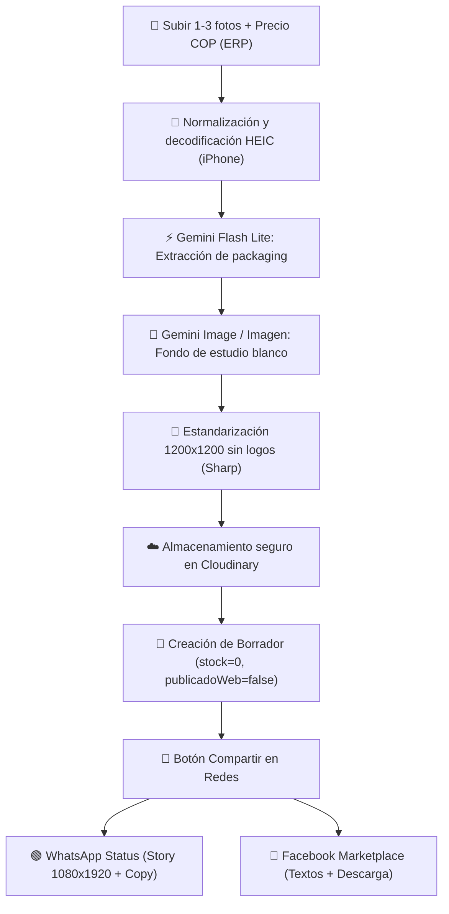

# Módulo de Creación Asistida por IA y Compartir en Redes — Documentación Técnica

> ⚠️ **Este archivo es un documento vivo.**
> Refleja la arquitectura, flujos y componentes implementados para la catalogación rápida con Inteligencia Artificial (Gemini) y publicación/difusión omnicanal en redes sociales (WhatsApp y Facebook Marketplace) para Edatia ERP y Distribuidora Baby World.

**Módulo:** Catálogo Digital / IA Productos & Redes  
**Submódulo:** `ia-productos`  
**Estado:** Completado, Desplegado y Verificado en Producción VPS (`edatia.com`) ✅  

---

## 1. Propósito y Flujo del Módulo

El objetivo es permitir a un comerciante o encargado de bodega catalogar un nuevo producto en menos de **30 segundos** simplemente tomando 1 a 3 fotos del empaque desde su celular o PC e ingresando el precio de venta en COP:



---

## 2. Arquitectura de Backend

### 2.1 Ubicación
* Módulo: `backend/src/digital/ia-productos/`
* Módulo padre: `backend/src/digital/digital.module.ts`

### 2.2 Servicios Implementados

| Servicio | Archivo | Responsabilidad |
| :--- | :--- | :--- |
| `IaProductosService` | `ia-productos.service.ts` | Orquestador del pipeline: valida archivos, consulta categorías existentes, invoca a Gemini, estandariza imágenes, sube a Cloudinary y guarda en Prisma. |
| `GeminiService` | `gemini.service.ts` | Conexión con la API de Google AI Studio. Modelo primario de texto: `gemini-flash-lite-latest` (con failover automático). Modelo de imagen: `gemini-2.5-flash-image` con prompt de encuadre en primer plano (88-92% de ocupación del lienzo, sombra de contacto sutil y remoción de etiquetas comerciales). |
| `ImagenEstandarService` | `imagen-estandar.service.ts` | Corrección EXIF, decodificación transparente de fotos Apple iPhone (`heic-convert`), auto-recorte inteligente de márgenes vacíos (`trim`) y encuadre centrado al **90% del lienzo** (1080 px en 1200×1200 px) para fotos de estudio/catálogo. Relleno automático con color de fondo detectado (o `#FFFFFF`), o versión desenfocada si la foto tiene fondo real de tienda. Sin superposición de logos ni distorsión. |

### 2.3 Endpoints REST

```http
POST   /api/v1/digital/ia/productos
       Content-Type: multipart/form-data
       Campos: fotos (1-3 archivos), precio (COP), notas (opcional)
       Respuesta: { borrador: Producto, advertenciaIa?: string }

POST   /api/v1/digital/ia/productos/:id/generar-info-publicacion
       Genera automáticamente los textos comerciales y SEO para e-commerce
       Respuesta: { nombreWeb, slug, etiquetaSeo, metaDescripcion, descripcionWeb }

POST   /api/v1/digital/ia/productos/:id/procesar-imagen-estudio
       Content-Type: multipart/form-data (archivo en 'file') o application/json ({ imageUrl })
       Genera fondo blanco estudio (#FFFFFF) 1:1 1200x1200 px con Gemini + Sharp sin logos
       Respuesta: { url: string, imagenes: string[], producto: Producto }

POST   /api/v1/digital/ia/productos/:id/estandarizar-imagen
       Content-Type: multipart/form-data (archivo en 'file') o application/json ({ imageUrl })
       Cuadra la foto 1:1 1200x1200 px SIN IA (solo Sharp), conservándola completa
       Respuesta: { url: string, imagenes: string[], producto: Producto }

POST   /api/v1/digital/ia/productos/:id/regenerar-imagen
       Body: { indice: number, modo: 'ia' | 'original', instruccion?: string }
       Respuesta: { producto: Producto, nuevaImagenUrl: string, indice: number }

PATCH  /api/v1/digital/ia/productos/:id
       Body: { nombre?, precioBase?, descripcion?, descripcionWeb?, categoriaId? }
       Respuesta: Producto actualizado

POST   /api/v1/digital/ia/productos/:id/compartido
       Body: { red: 'whatsapp' | 'instagram' | 'tiktok' | 'marketplace' }
       Respuesta: { success: true, red: string, fecha: string }

GET    /api/v1/public/tiendas/:slug/og/:productoSlug
       Endpoint público HTML para crawlers (WhatsApp, Facebook, Twitter, Telegram)
       Devuelve etiquetas Open Graph dinámicas (og:title, og:image, og:description)
```

### 2.4 Cuadrar imágenes existentes del catálogo

Script `backend/scripts/cuadrar_imagenes_catalogo.js`: recorre las imágenes de los productos de una empresa, deja intactas las que ya son cuadradas (tolerancia 2%) y cuadra el resto con `ImagenEstandarService`. Es reversible: guarda `metadataWeb.imagenesAntesCuadrar` (`{ urlNueva: urlAnterior }`) y no borra nada de Cloudinary.

```bash
docker cp backend/scripts/cuadrar_imagenes_catalogo.js edatia-backend:/app/cuadrar.js
docker exec -w /app edatia-backend node /app/cuadrar.js --empresa 2              # simulación
docker exec -w /app edatia-backend node /app/cuadrar.js --empresa 2 --muestras 8 # + vistas previas en /tmp/cuadrar-preview
docker exec -w /app edatia-backend node /app/cuadrar.js --empresa 2 --aplicar    # aplica
docker exec -w /app edatia-backend node /app/cuadrar.js --empresa 2 --revertir --aplicar
```

> En la tienda virtual (`ProductCard`), las imágenes se muestran con `object-contain` sobre fondo blanco, por lo que tampoco se recortan fotos no cuadradas.

---

## 3. Integración con Google Gemini & Facturación Prepay

1. **Modelos Utilizados:**
   - **Análisis y Extracción:** `gemini-flash-lite-latest` (Ultra rápido, ~1 segundo por producto).
   - **Fondo de Estudio:** `gemini-2.5-flash-image` (Genera renderización con iluminación de catálogo y sombra de contacto suave).
2. **Compatibilidad con Google Cloud Prepay:**
   - La API key utiliza facturación vinculada (*Pay-As-You-Go* con billetera prepago de AI Studio).
   - Consume automáticamente los créditos promocionales del Google Developer Program ($31.635 COP mensuales) y el crédito de bienvenida de Google Cloud ($949.041 COP).
3. **Resiliencia:**
   - Si la llamada de imagen falla por latencia o cuota, el sistema degrada limpiamente a la foto normalizada y centrada localmente por `sharp`, garantizando que el usuario nunca quede bloqueado.
4. **Optimización de Escala y Encuadre (90% Close-Up):**
   - El prompt instruye a Gemini generar tomas en primer plano (`88-92%`) con sombra directa en la base (evitando que el producto parezca flotar o verse alejado).
   - Sharp aplica `trim` de umbral para remover márgenes artificiales y remonta el producto ocupando el 90% del lienzo cuadrado de 1200×1200 px.

---

## 4. Arquitectura de Frontend

* **Componentes Clave:**
  - `ModalProductoIa.tsx`: Modal responsivo con arrastrar y soltar, subida de fotos, atajo de pegado desde portapapeles (`Ctrl + V`), barra de progreso en tiempo real, visor de miniaturas con fallback amigable para iPhone (HEIC), y editor rápido en línea de títulos y precios.
  - `CompartirRedesModal.tsx`:
    - **Transcodificación Forzada a JPEG Universal (`f_jpg`):** Utiliza la función helper `prepararUrlCloudinary` que inyecta `,f_jpg/` y reemplaza la extensión a `.jpg`, obligando a Cloudinary a servir siempre un estándar JPEG baseline (JFIF) con fondo blanco puro `#FFFFFF`, resolviendo problemas de incompatibilidad o archivos dañados en la aplicación Fotos de Windows y WhatsApp.
    - **Descarga Asíncrona Robusta:** Limpieza de nombres de archivo para asegurar una única extensión `.jpg` (evitando extensiones duplicadas como `.jpg.jpeg`) y retardo en la revocación del Blob (`setTimeout`) para permitir que el sistema operativo y el navegador completen la escritura en disco sin truncamiento.
    - **Flujo Adaptativo Móvil vs. PC:**
      - En smartphones reales (Android / iOS): Invoca la Web Share API nativa (`navigator.share`) para compartir directamente en *"WhatsApp > Mi Estado"*.
      - En computadores de escritorio (Windows / Mac / Linux): Descarga automáticamente la foto nítida (1080×1920 para Estado o 1200×1200 para Feed), copia el texto con el enlace al portapapeles y abre WhatsApp Web de forma fluida.
      - Incluye botón dedicado **"⬇️ Descargar JPG"** en la tarjeta de previsualización para bajar el archivo con 1 solo clic.
    - **Estructura de Copy Orientada a Conversión:** El enlace directo al producto en la tienda virtual se ubica estratégicamente en la **parte superior** del texto sugerido, garantizando que los clientes lo vean de inmediato sin necesidad de desplegar el mensaje completo.
    - **Pestañas Multicanal:**
      - **WhatsApp:** Opciones de formato vertical para estados (1080×1920) o cuadrado (1200×1200), envío directo por chat (`api.whatsapp.com/send`) y publicación en Estado.
      - **Instagram:** Selector de formato Feed (1:1) o Story (9:16), copy comercial con hashtags locales colombianos de maternidad y juguetes, descarga de imagen y enlace a Instagram.
      - **TikTok:** Guion publicitario estructurado con gancho (Hook 0-3s), desarrollo de beneficios, precio y llamada a la acción (CTA) con hashtags virales, descarga de imagen 9:16 y acceso directo a la plataforma.
      - **Facebook Marketplace:** Formato optimizado para copiar título limpio, precio en COP, descripción con enlace web y descarga de imagen cuadrada estandarizada de 1200×1200 px.
  - `ConfigProductoDetalle.tsx` (Pestaña "Web / Digital"):
    - **Encabezado Optimizado:** Se removieron los botones repetidos del encabezado general para mantener la interfaz despejada y profesional, centralizando los accesos en el banner destacado.
    - **Banner Difusión Omnicanal:** Bloque interactivo con accesos directos a WhatsApp, Instagram, TikTok y Marketplace.
    - **Autogeneración con IA Multimodal (OCR Visual):** Botón `✨ Autogenerar con IA` en la tarjeta "Información de Publicación" que genera y puebla automáticamente `nombreWeb`, `slug`, `etiquetaSeo`, `metaDescripcion` y `descripcionWeb`. Envía la URL de la imagen principal procesada (`imageUrl`) para que `gemini-flash-lite` lea directamente marcas, textos del empaque, edades sugeridas y advertencias mediante OCR visual multimodal, con fallback automático a texto.
    - **Fondo de Estudio IA en Imágenes:** Checkbox toggle activado por defecto para aplicar fondo blanco estudio puro (`#FFFFFF`) 1200×1200 px sin logos en cualquier foto nueva. Incluye botón de varita mágica `✨` en cada miniatura para convertir fotos existentes a demanda. Con el toggle apagado, las fotos (archivo o URL) pasan por `estandarizar-imagen` y quedan cuadradas 1:1, asegurando que la tienda virtual nunca las recorte.
    - **Visor Lightbox Interactivo de Imágenes:**
      - Miniaturas ampliadas (48×48 px) con esquinas redondeadas, sombra suave e indicador interactivo de ojo (`👁️`).
      - Modal Lightbox en pantalla completa con imagen en alta resolución sobre fondo de estudio blanco.
      - Navegación táctil y por teclado con flechas izquierda/derecha (`←` y `→`) y cierre con tecla `Escape` o clic fuera del modal.
      - Contador de imágenes (`X de N`), indicador de imagen principal y acciones integradas: *Hacer Principal* con 1 clic, *Fondo Blanco IA* directamente en el visor y *Abrir original en pestaña nueva*.
  - `CatalogoDigital.tsx`: Integración de accesos directos de difusión omnicanal y creación asistida por IA.

---

## 5. Experiencia de Usuario en Tienda Virtual (`distribuidorababyworld`)

Para maximizar la conversión en la tienda online y aprovechar las fotos de estudio de alta definición:

1. **Lupa Dinámica Interactiva (Hover Zoom 2.2x):**
   - Implementada en `ProductDetailPage.tsx` y `ProductDetailModal.tsx`.
   - Cursor en cruz (`cursor-crosshair`) con seguimiento dinámico del puntero (`transformOrigin: x% y%`) y ampliación fluida del **220%** sin pixelación.
   - Permite al comprador inspeccionar detalles clave del producto (texturas, advertencias de empaque, certificados de seguridad, piezas incluidas).
   - Incluye badge flotante interactivo: `🔍 Lupa zoom` / `Pasa el cursor`.
2. **Visor Lightbox Pantalla Completa:**
   - Accesible haciendo clic directo en el escenario de la imagen o mediante el botón flotante `⛶`.
   - Fondo oscuro translúcido con efecto de desenfoque (`backdrop-blur-md`).
   - Navegación táctil, selector inferior de miniaturas y atajos de teclado (`Esc`, `←`, `→`).
3. **Escenario Blanco de Integración (`bg-white`):**
   - Contenedor con fondo blanco puro y borde sutil que se funde con los fondos de estudio generados por IA.
4. **Mapeo Comercial y Resiliencia en Rutas:**
   - `App.tsx` prioriza `p.metadataWeb?.nombreWeb || p.nombreWeb || p.nombre` para mostrar siempre el título comercial persuasivo optimizado para e-commerce.
   - Búsqueda tolerante en deep links de productos (`/producto/:slug` o `?p=:slug`) resolviendo contra `slug`, nombre con slugify, SKU o ID.
   - Cabeceras HTTP `no-cache, no-store, must-revalidate` en API pública y `{ cache: 'no-store' }` en `fetch` para garantizar sincronización instantánea sin que el caché del navegador retenga datos antiguos.
5. **Paridad de Descuentos en Modal y Página:**
   - La modal de vista rápida (`ProductDetailModal.tsx`) cuenta con la misma visualización de descuentos promocionales que la página de detalle: badges `-X% OFF`, precio tachado y ahorro calculado en COP (`¡Ahorras $X!`).
6. **Protección Integral contra Imágenes Rotas (`onError` Fallback):**
   - En `ProductCard.tsx`, `ProductDetailModal.tsx` y `ProductDetailPage.tsx` (incluyendo miniaturas de la galería y modal Lightbox), todos los elementos `` cuentan con manejadores `onError` vinculados a `FALLBACK_IMAGE`. Si una URL externa o de Cloudinary no responde (HTTP 404), la interfaz degrada limpiamente sin dejar recuadros en blanco ni íconos rotos del navegador.

---

## 6. Detección de Bots Sociales y Open Graph

En `tiendas-virtuales/distribuidorababyworld/Caddyfile`, se implementó el enrutamiento condicional mediante bloques `handle` mutuamente excluyentes:
```caddy
@crawlers {
    header_regexp User-Agent "(?i)(facebookexternalhit|WhatsApp|TelegramBot|Twitterbot|LinkedInBot|Discordbot)"
    path_regexp prod ^/producto/([^/?#]+)
}
handle @crawlers {
    reverse_proxy http://api:4000 {
        rewrite /api/v1/public/tiendas/distribuidorababyworld/og/{re.prod.1}
    }
}

handle {
    @html {
        path *.html
        path /
    }
    header @html Cache-Control "no-cache, no-store, must-revalidate"
    header @html Pragma "no-cache"
    header @html Expires "0"

    try_files {path} /index.html
    file_server
}
```
Esto garantiza que la directiva `try_files` no intercepte prematuramente las solicitudes de los bots, asegurando que cuando un enlace del producto se comparta por chat o publicación, WhatsApp, Facebook, Telegram, Twitter y Discord reciban de inmediato la tarjeta con imagen grande en alta resolución, nombre y precio en COP. Los navegadores de usuarios finales son atendidos por el bloque `handle` secundario cargando la SPA normalmente.

---

## 7. Verificación y Calidad

- **Sin logs residuales:** Sin llamadas de depuración (`console.log`, `var_dump`) en el código de producción.
- **Seguridad:** `.env` verificado en `.gitignore`; clave de API protegida exclusivamente en el backend.
- **Higiene:** Scripts de diagnóstico y binarios temporales eliminados del repositorio.
- **Compatibilidad móvil:** Probado con fotos HEIC nativas de iOS y encuadres responsivos.

