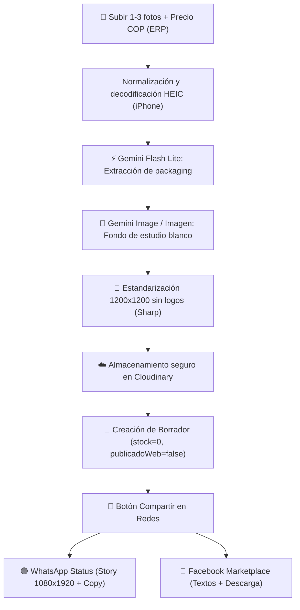

# Módulo de Creación Asistida por IA y Compartir en Redes — Documentación Técnica

> ⚠️ **Este archivo es un documento vivo.**
> Refleja la arquitectura, flujos y componentes implementados para la catalogación rápida con Inteligencia Artificial (Gemini) y publicación/difusión omnicanal en redes sociales (WhatsApp y Facebook Marketplace) para Edatia ERP y Distribuidora Baby World.

**Módulo:** Catálogo Digital / IA Productos & Redes  
**Submódulo:** `ia-productos`  
**Estado:** Completado y Verificado en Producción Local ✅  

---

## 1. Propósito y Flujo del Módulo

El objetivo es permitir a un comerciante o encargado de bodega catalogar un nuevo producto en menos de **30 segundos** simplemente tomando 1 a 3 fotos del empaque desde su celular o PC e ingresando el precio de venta en COP:



---

## 2. Arquitectura de Backend

### 2.1 Ubicación
* Módulo: `backend/src/digital/ia-productos/`
* Módulo padre: `backend/src/digital/digital.module.ts`

### 2.2 Servicios Implementados

| Servicio | Archivo | Responsabilidad |
| :--- | :--- | :--- |
| `IaProductosService` | `ia-productos.service.ts` | Orquestador del pipeline: valida archivos, consulta categorías existentes, invoca a Gemini, estandariza imágenes, sube a Cloudinary y guarda en Prisma. |
| `GeminiService` | `gemini.service.ts` | Conexión con la API de Google AI Studio. Modelo primario de texto: `gemini-flash-lite-latest` (con failover automático). Modelo de imagen: `gemini-2.5-flash-image`. |
| `ImagenEstandarService` | `imagen-estandar.service.ts` | Corrección EXIF, decodificación transparente de fotos Apple iPhone (`heic-convert`), centrado y recorte en lienzo cuadrado de 1200×1200 px con fondo blanco puro `#FFFFFF`. Sin superposición de logos. |

### 2.3 Endpoints REST

```http
POST   /api/v1/digital/ia/productos
       Content-Type: multipart/form-data
       Campos: fotos (1-3 archivos), precio (COP), notas (opcional)
       Respuesta: { borrador: Producto, advertenciaIa?: string }

POST   /api/v1/digital/ia/productos/:id/generar-info-publicacion
       Genera automáticamente los textos comerciales y SEO para e-commerce
       Respuesta: { nombreWeb, slug, etiquetaSeo, metaDescripcion, descripcionWeb }

POST   /api/v1/digital/ia/productos/:id/procesar-imagen-estudio
       Content-Type: multipart/form-data (archivo en 'file') o application/json ({ imageUrl })
       Genera fondo blanco estudio (#FFFFFF) 1:1 1200x1200 px con Gemini + Sharp sin logos
       Respuesta: { url: string, imagenes: string[], producto: Producto }

POST   /api/v1/digital/ia/productos/:id/regenerar-imagen
       Body: { indice: number, modo: 'ia' | 'original', instruccion?: string }
       Respuesta: { producto: Producto, nuevaImagenUrl: string, indice: number }

PATCH  /api/v1/digital/ia/productos/:id
       Body: { nombre?, precioBase?, descripcion?, descripcionWeb?, categoriaId? }
       Respuesta: Producto actualizado

POST   /api/v1/digital/ia/productos/:id/compartido
       Body: { red: 'whatsapp' | 'instagram' | 'tiktok' | 'marketplace' }
       Respuesta: { success: true, red: string, fecha: string }

GET    /api/v1/public/tiendas/:slug/og/:productoSlug
       Endpoint público HTML para crawlers (WhatsApp, Facebook, Twitter, Telegram)
       Devuelve etiquetas Open Graph dinámicas (og:title, og:image, og:description)
```

---

## 3. Integración con Google Gemini & Facturación Prepay

1. **Modelos Utilizados:**
   - **Análisis y Extracción:** `gemini-flash-lite-latest` (Ultra rápido, ~1 segundo por producto).
   - **Fondo de Estudio:** `gemini-2.5-flash-image` (Genera renderización con iluminación de catálogo y sombra de contacto suave).
2. **Compatibilidad con Google Cloud Prepay:**
   - La API key utiliza facturación vinculada (*Pay-As-You-Go* con billetera prepago de AI Studio).
   - Consume automáticamente los créditos promocionales del Google Developer Program ($31.635 COP mensuales) y el crédito de bienvenida de Google Cloud ($949.041 COP).
3. **Resiliencia:**
   - Si la llamada de imagen falla por latencia o cuota, el sistema degrada limpiamente a la foto normalizada y centrada localmente por `sharp`, garantizando que el usuario nunca quede bloqueado.

---

## 4. Arquitectura de Frontend

* **Componentes Clave:**
  - `ModalProductoIa.tsx`: Modal responsivo con arrastrar y soltar, subida de fotos, atajo de pegado desde portapapeles (`Ctrl + V`), barra de progreso en tiempo real, visor de miniaturas con fallback amigable para iPhone (HEIC), y editor rápido en línea de títulos y precios.
  - `CompartirRedesModal.tsx`:
    - **Pestaña WhatsApp:** Genera imagen vertical de estado/story (1080×1920 px con Cloudinary padding), botón de compartir nativo móvil (`navigator.share`), botón directo para enviar a clientes por chat (`wa.me/?text=...`) y botón para WhatsApp Web en escritorio con copy publicitario optimizado con emojis y llamado a la acción.
    - **Pestaña Instagram:** Selector Feed (1:1) o Story (9:16), copia de caption comercial persuasivo con emojis y hashtags locales colombianos de bebés y maternidad, descarga de imagen y acceso directo a Instagram.
    - **Pestaña TikTok:** Guion publicitario estructurado con gancho (Hook 0-3s), presentación, precio y llamado a la acción (CTA) con hashtags virales, descarga de imagen vertical (9:16) y apertura directa a TikTok.
    - **Pestaña Facebook Marketplace:** Formato semi-automatizado para copiar Título limpio, Precio en COP, Descripción detallada con URL directa a la tienda y botón de descarga de la foto de catálogo.
  - `ConfigProductoDetalle.tsx` (Pestaña "Web / Digital"):
    - **Autogeneración con IA:** Botón `✨ Autogenerar con IA` en la tarjeta "Información de Publicación" que genera automáticamente y puebla `nombreWeb`, `slug`, `etiquetaSeo`, `metaDescripcion` y `descripcionWeb`.
    - **Fondo de estudio IA en Imágenes (URLs):** Checkbox toggle activado por defecto para que cualquier foto subida, arrastrada o agregada por URL pase por el procesamiento de fondo blanco estudio puro (`#FFFFFF`) 1200×1200 px sin logos. Incluye botón de varita mágica `✨` en cada miniatura para convertir fotos existentes a estudio a demanda.
    - **Difusión en Redes:** Barra omnicanal superior y botones directos por producto en el encabezado (WhatsApp, Instagram, TikTok y Marketplace).
  - `CatalogoDigital.tsx`: Botones de difusión omnicanal y creación asistida rápida.

---

## 5. Detección de Bots Sociales y Open Graph

En `tiendas-virtuales/distribuidorababyworld/Caddyfile`, se implementó el proxy inverso condicional:
```caddy
@crawlers {
    header_regexp User-Agent "(?i)(facebookexternalhit|WhatsApp|TelegramBot|Twitterbot|LinkedInBot|Discordbot)"
    path_regexp prod ^/producto/([^/?#]+)
}
reverse_proxy @crawlers http://api:4000 {
    rewrite /api/v1/public/tiendas/distribuidorababyworld/og/{re.prod.1}
}
```
Esto asegura que cuando un enlace del producto se comparta por chat o publicación, WhatsApp y Facebook reciban de inmediato la tarjeta con imagen grande en alta resolución, nombre y precio en COP sin renderizar la SPA.

---

## 6. Verificación y Calidad

- **Sin logs residuales:** Sin llamadas de depuración (`console.log`, `var_dump`) en el código de producción.
- **Seguridad:** `.env` verificado en `.gitignore`; clave de API protegida exclusivamente en el backend.
- **Higiene:** Scripts de diagnóstico y binarios temporales eliminados del repositorio.
- **Compatibilidad móvil:** Probado con fotos HEIC nativas de iOS y encuadres responsivos.

